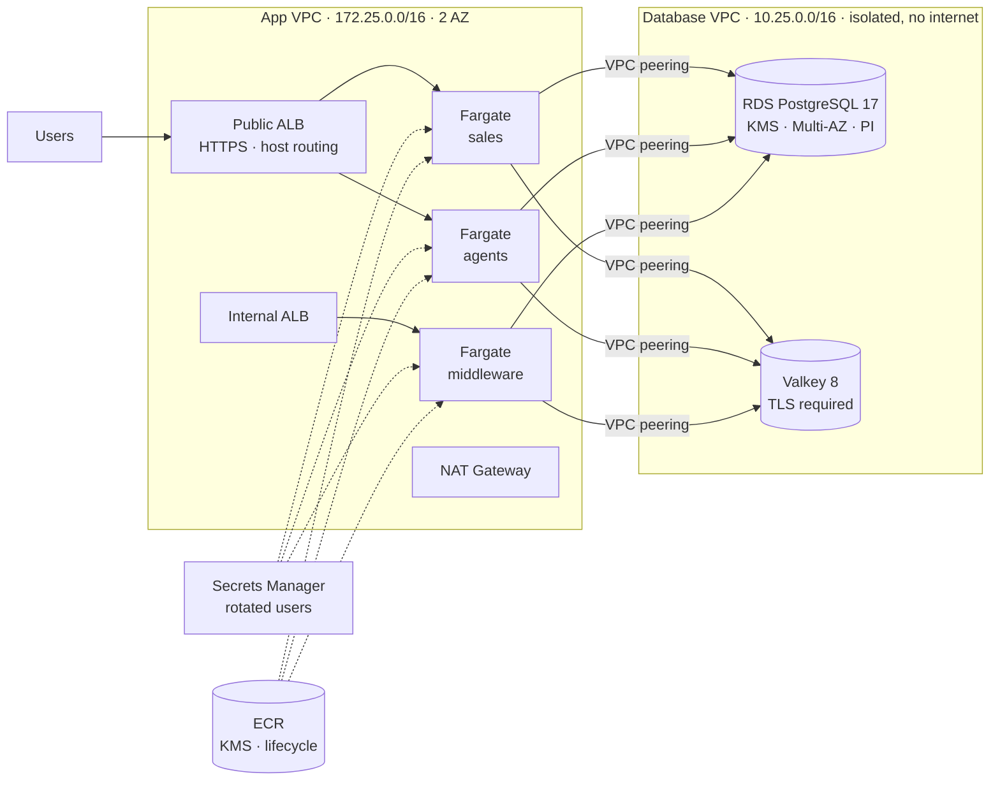

# AWS CDK · ECS Fargate + PostgreSQL + Valkey

A config-driven AWS platform in **AWS CDK (JavaScript)** for containerized web apps: ECS Fargate services behind public and internal load balancers, **RDS PostgreSQL 17** with automatically rotated users, and a **Valkey** (Redis-compatible) cache, with all data kept in an isolated VPC.

It is a sanitized version of infrastructure I built for an insurance SaaS (online sales, agent portal and integration middleware). The same service-list pattern also powered an ECS template I used across 15 client environments when moving workloads from Elastic Beanstalk to Fargate. Client names, account IDs and domains have been replaced with placeholders.

   

## Architecture



## What it builds

| Stack | What it does |
| --- | --- |
| `vpcEnvironments` | App VPC across 2 AZs with public and private subnets and a NAT gateway. |
| `vpcDatabase` | Data VPC with **isolated subnets only**: no internet gateway, no NAT. |
| `vpcPeering` | Peering between both VPCs with explicit routes. |
| `rdsPostgresql` | PostgreSQL 17 encrypted with a customer-managed KMS key, deletion protection, 7-day backups, Performance Insights, query logging to CloudWatch, storage autoscaling. Three users (master, ECS app, Lambda app), each in Secrets Manager with **automatic rotation** handled by Lambdas inside the VPC. |
| `valkeyCache` | ElastiCache Valkey 8 with encryption at rest and **TLS required** in transit, auth token stored in Secrets Manager. Optional per environment. |
| `EcsStack` | ECS Fargate cluster, one service per entry in the config: ECR repo encrypted with its own KMS key and 30-day image lifecycle, task definition, log group, target group and host-based listener rule on the public or internal ALB. HTTP → HTTPS redirect, optional CPU/memory autoscaling, and DB/cache endpoints injected as environment variables. |

## Add a service without touching code

Services live in `config/<env>.json`:

```json
{
  "name": "agents",
  "albType": "public",
  "subdomain": "agents",
  "cpu": 512,
  "memoryLimitMiB": 1024,
  "desiredCount": 2,
  "priority": 20,
  "healthCheckPath": "/",
  "autoscaling": { "min": 2, "max": 4, "cpuTarget": 70 }
}
```

Deploy and you get the ECR repository, task definition, Fargate service, target group, listener rule and scaling policy.

To deploy into a VPC that already exists (for example when migrating Elastic Beanstalk apps in place), pass `existingVpcId` to `EcsServicesStack` instead of `vpcEnvironments`.

## Design decisions

- **Data has no route to the internet.** The database VPC only has isolated subnets; security groups only accept the app VPC CIDR on the database and cache ports.
- **No shared database password.** Each consumer gets its own database user, and Secrets Manager rotates them on a schedule.
- **Encryption everywhere.** KMS keys for the database, Performance Insights, the cache and every ECR repository.
- **Dev is cheap, prod is resilient.** The same code runs single-AZ without a cache in `dev.json` and Multi-AZ with Valkey in `prod.json`.

## Usage

```bash
npm install
cp config/example.json config/prod.json   # set domain, certificate ARN, CIDRs and services
npx cdk synth --all -c config=prod
npx cdk deploy --all -c config=prod
```

Tests run offline, no AWS account needed:

```bash
npx jest
```

## Project layout

```
bin/app.js            entry point, picks config/<name>.json
config/               one JSON file per environment
lib/platform.js       wires the stacks together
lib/vpc/              app VPC, database VPC, peering
lib/database/         RDS PostgreSQL, KMS, rotated users
lib/cache/            Valkey replication group
lib/environments/     ECS Fargate services and ALBs
test/                 jest assertions on the synthesized templates
```

## See also

[aws-cdk-secure-platform](https://github.com/cfarez19/aws-cdk-secure-platform): the same network model with DocumentDB, four WAF Web ACLs, API Gateway over VPC Link and cross-region backup.

## Author

**Catalina Farez** — AWS Cloud Architect (AWS Certified Solutions Architect – Associate).
I design, migrate and secure AWS platforms for fintech and insurance teams. Available for freelance work.
